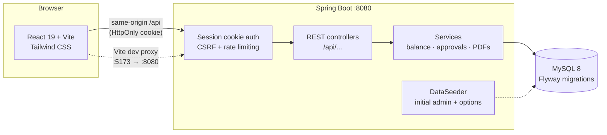

# deposit.in — Deposit (`+`) & Withdrawal (`-`) ERP Ledger

A complete **Admin & User Deposit/Withdrawal Ledger ERP** with an Admin Approval
workflow, admin-managed entry options, and PDF/CSV statement exports.

- **Admin Role (`ADMIN`):**
  - **Direct User Creation (Name & Password only):** create a user with just a name and
    password — the account code and ledger are generated automatically.
  - **Admin-Controlled Entry Options:** manage the dropdown options users must pick from
    when submitting an entry (e.g. `Cash Deposit`, `UPI / Bank Deposit`, `Cash Withdrawal`,
    `Site Material`, `Petrol / Transport`, …) from **Settings → Entry options**.
  - **Approve / Reject Queue:** review user-submitted **Deposit (`+`)** and
    **Withdrawal (`-`)** requests (`✓ Approve` or `✕ Reject` with a reason), with a live
    pending count badge in the sidebar.
  - **Direct Deposit / Withdrawal:** record an entry for any user — admin entries are
    approved immediately.
  - **1-Click Password Reset (`Reset password`):** set a new password for any user from
    the user's edit page. Users can never change their own password.
  - **Reversals:** reverse a wrongly approved entry once — an offsetting entry keeps the
    audit trail intact.
  - **PDF/CSV Downloads:** any user's ledger as `.pdf` or `.csv` (with All Time /
    This Month / Last Month quick filters) and an **All Users Summary PDF** from the
    Dashboard.
- **Normal User Role (`USER`):**
  - Signs in with the **Name** and **Password** given by the Admin.
  - **Password Locked to Admin:** only the Admin can reset a password.
  - **Private User Portal:** users see only their own entries, net balance and pending
    status — never another user's ledger.
  - **Submit Deposit (`+`) or Withdrawal (`-`):** pick an admin-configured option, add an
    optional detail/remark (`"2 bag cement"`, `"ATM"`), submit for approval.

Money is tracked as **balance = approved deposits − approved withdrawals**. Pending and
rejected entries never change the balance. All amounts are decimal strings — no floating
point math anywhere in the stack.

**Stack**

- **Frontend:** React 19, Vite, TypeScript, Tailwind CSS (`frontend/`)
- **Backend:** Java 21, Spring Boot 3.2, Spring Security, Hibernate/JPA (`backend/`)
- **Database:** MySQL 8 (H2 in-memory for demos and tests)
- **Schema:** Flyway migrations (`backend/src/main/resources/db/migration/`)
- **Docs:** [API reference](docs/API.md)

---

## Architecture



- **Auth:** HttpOnly session cookie (`erp_session`). The browser never stores tokens.
  Write requests need `X-Requested-With: XMLHttpRequest` (CSRF protection), and login is
  rate-limited (10 failures / 15 min per name+IP).
- **Approvals:** users submit `PENDING` entries; admins approve or reject. Admin-created
  entries are `APPROVED` immediately. Approval is race-safe (decide exactly once).
- **Privacy:** every query is scoped — a `USER` can only read/write their own account.

---

## Part 1: Local setup (VS Code)

### Prerequisites

| Tool | Version | Link |
|---|---|---|
| **JDK** | **21+** | https://adoptium.net |
| **Node.js** | **20.19+** (LTS) | https://nodejs.org |
| **MySQL Server** | **8.0+** (or MariaDB / XAMPP) | https://dev.mysql.com/downloads/installer/ |

### Three steps

```bash
# 1. Install frontend dependencies
npm run setup

# 2. Create the database
mysql -u root -p -e "CREATE DATABASE depositin CHARACTER SET utf8mb4 COLLATE utf8mb4_unicode_ci;"

# 3. Configure and run (backend :8080 + frontend :5173)
cd backend
cp .env.example .env            # then put your MySQL password in DB_URL/DB_USER/DB_PASSWORD
cd ..
npm run dev                     # uses the in-memory demo DB — see below
```

`npm run dev` starts the backend with the **`demo-h2`** Maven profile and the
**`dev-h2`** Spring profile — an in-memory database with a seeded admin
(`admin` / `AdminPass123`), so you can try everything without MySQL. To run against
your real MySQL instead:

```bash
cd backend
./mvnw spring-boot:run          # picks up .env / environment variables (MySQL)
cd ../frontend && npm run dev
```

Sign in at http://localhost:5173 as `admin` / `AdminPass123` (demo) or the admin
printed in the backend log on first production start — **change it immediately**.

### Useful root scripts

| Script | What it does |
|---|---|
| `npm run setup` | Install frontend dependencies |
| `npm run dev` | Backend (demo DB) + frontend, one terminal |
| `npm run dev:backend` / `dev:frontend` | Run one side only |
| `npm run build` | Production jar (`backend/target/depositin-erp-1.0.0.jar`) + frontend `dist/` |
| `npm run test` | Full backend test suite (52 JUnit tests) |
| `npm run start` | Run the packaged jar (needs MySQL env vars) |

---

## Part 2: Deploy to a VPS (Java + MySQL)

The production artifact is a single self-contained jar. The frontend builds to static
files served by any web server (Nginx below).

### 1. Server packages

```bash
sudo apt update
sudo apt install -y openjdk-21-jre mysql-server nginx
```

### 2. Database

```sql
CREATE DATABASE depositin CHARACTER SET utf8mb4 COLLATE utf8mb4_unicode_ci;
CREATE USER 'depositin'@'localhost' IDENTIFIED BY 'CHANGE_ME_STRONG';
GRANT ALL PRIVILEGES ON depositin.* TO 'depositin'@'localhost';
FLUSH PRIVILEGES;
```

### 3. Build and upload

```bash
npm run build            # locally or on the server (needs JDK 21 + Node 20)
scp backend/target/depositin-erp-1.0.0.jar user@your-vps:/opt/depositin/
scp -r frontend/dist user@your-vps:/opt/depositin/frontend-dist
```

### 4. Systemd service

`/etc/systemd/system/depositin.service`:

```ini
[Unit]
Description=deposit.in ERP
After=network.target mysql.service

[Service]
User=www-data
WorkingDirectory=/opt/depositin
Environment=DB_URL=jdbc:mysql://localhost:3306/depositin?useSSL=false&serverTimezone=Asia/Kolkata
Environment=DB_USER=depositin
Environment=DB_PASSWORD=CHANGE_ME_STRONG
Environment=ADMIN_NAME=admin
Environment=ADMIN_PASSWORD=CHANGE_ME_STRONG
Environment=COOKIE_SECURE=true
Environment=TRUST_PROXY=true
ExecStart=/usr/bin/java -jar /opt/depositin/depositin-erp-1.0.0.jar --server.port=8080
Restart=on-failure

[Install]
WantedBy=multi-user.target
```

```bash
sudo systemctl daemon-reload
sudo systemctl enable --now depositin
sudo journalctl -u depositin -f      # first start prints the seeded admin password
```

Flyway creates/updates the schema automatically on startup. On the very first start the
backend seeds the initial administrator (`ADMIN_NAME`/`ADMIN_PASSWORD`, or a random
password printed once to the log) and the default entry options — reset the password
immediately.

### 5. Nginx (HTTPS + static frontend + API proxy)

```nginx
server {
    listen 443 ssl;
    server_name your-domain.com;

    ssl_certificate     /etc/letsencrypt/live/your-domain.com/fullchain.pem;
    ssl_certificate_key /etc/letsencrypt/live/your-domain.com/privkey.pem;

    root /opt/depositin/frontend-dist;
    index index.html;
    location / {
        try_files $uri /index.html;
    }
    location /api/ {
        proxy_pass http://127.0.0.1:8080;
        proxy_set_header Host $host;
        proxy_set_header X-Forwarded-For $proxy_add_x_forwarded_for;
        proxy_set_header X-Forwarded-Proto $scheme;
    }
}
```

### Environment variables

| Variable | Default | Purpose |
|---|---|---|
| `DB_URL` | `jdbc:mysql://localhost:3306/depositin` | JDBC URL |
| `DB_USER` / `DB_PASSWORD` | — | Database credentials |
| `PORT` / `SERVER_PORT` | `8080` | HTTP port |
| `ADMIN_NAME` / `ADMIN_PASSWORD` | `admin` / random | Initial administrator |
| `COOKIE_SECURE` | `true` | Set `false` only for plain-HTTP demos |
| `COOKIE_SAME_SITE` | `Lax` | Cookie policy |
| `TRUST_PROXY` | `false` | `true` behind Nginx |
| `ALLOWED_ORIGINS` | same-origin | CORS origins for split hosting |
| `APP_TIMEZONE` | `Asia/Kolkata` | Business timezone |
| `SESSION_IDLE_MINUTES` / `SESSION_MAX_HOURS` | `120` / `12` | Session limits |

---

## Testing

```bash
cd backend && ./mvnw test
```

52 integration tests cover the acceptance criteria end to end (MockMvc + H2 in MySQL
mode): login/rate limiting, role enforcement, user creation, the approval workflow and
its race, balance rules, entry-option validation, date filters, reversals, ledger
privacy, password-reset flows, and PDF/CSV exports. Optional Testcontainers-based
MySQL tests can be added for CI environments with Docker.

## Security notes

- HttpOnly session cookies; session tokens are stored server-side as SHA-256 hashes.
- Users cannot change their own password — the API answers `PASSWORD_CHANGE_DISABLED`.
- Admin password resets revoke all of that user's sessions immediately.
- Failed logins are rate-limited; security events land in the append-only audit log.
- Run behind HTTPS (`COOKIE_SECURE=true`) in production.

